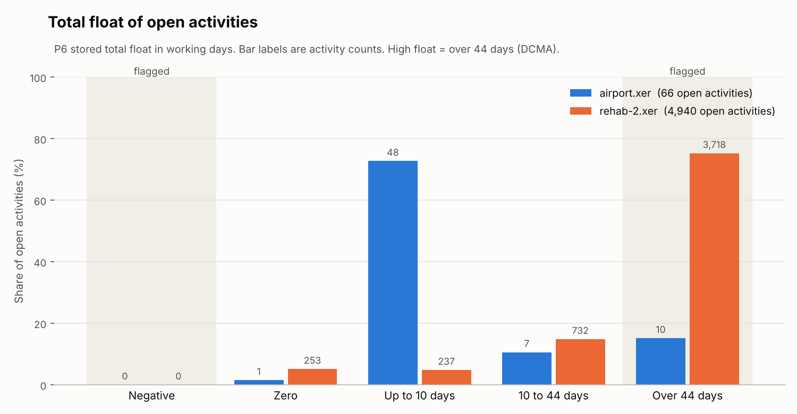

# XER schedule checker

A small checker for Primavera P6 `.xer` exports. It reads the file with its own parser, flags broken rows, runs three schedule checks (missing links, negative float, high float), and draws one chart.

The full results are in [`reports/report.md`](reports/report.md).



## What it found

| | `airport.xer` | `rehab-2.xer` |
|---|---|---|
| Activities (open / total) | 66 / 66 | 4,940 / 6,977 |
| Relationships | 84 | 10,730 |
| Broken rows | 0 | 0 |
| Missing links | 0 | 10 |
| Negative float | 0 | 0 |
| High float (over 44 days) | 10 (15%) | 3,718 (75%) |
| Time to read and check | 0.01 s | about 1.1 s |

**airport.xer** (TERMINAL-2, P6 5.0) is clean on structure and logic. 15% of its open activities have more than 44 working days of float, which is above the 5% the DCMA guideline allows. P6 flags 36 activities on its longest path. Apart from the start milestone, each of them carries 1 day of float rather than 0, which is often a sign of a finish deadline one day after the calculated finish. That's why the checker reads P6's own longest-path flag instead of treating "zero float" as "critical".

**rehab-2.xer** (R111, P6 6.0) is the more interesting file:
- **It's in Arabic.** The activity names are in the Windows Arabic encoding. Read as Western text, "بداية المشروع" (project start) comes out as "ÈÏÇíÉ ÇáãÔÑæÚ". The checker detects the encoding and keeps names readable in the report and the CSV.
- **10 open activities have no successor.** They're mostly external painting and formwork stripping, so a delay on them wouldn't push anything later in the schedule.
- **75% of open activities have more than 44 days of float.** That's far above the 5% guideline. A pattern like this usually means logic is missing downstream, or the finish is far beyond the work. A scheduler should look at it before trusting the critical path.

## Run it

Needs Python 3.9 or newer.

```bash
pip install -r requirements.txt
python check_xer.py data/airport.xer data/rehab-2.xer      # writes reports/
python check_xer.py tests/fixtures/broken.xer --out reports/broken-demo
python -m unittest                                          # 15 tests
```

Each run writes `report.md`, `float_profile.png`, and one `<file>_findings.csv` per schedule listing every finding. The CSV is saved so Excel shows Arabic correctly.

## What is checked

**Broken rows.** Each problem is reported with its line number, and nothing is silently fixed:
- a row whose number of values doesn't match its table header (left out of every check)
- a duplicate or missing activity ID
- total float or lag that isn't a number
- a date that doesn't parse
- an activity on a calendar that isn't in the file
- a link to an activity that isn't in the file
- an open activity with no float
- a missing header, missing required table, or missing end marker (a cut-off file)

[`tests/fixtures/broken.xer`](tests/fixtures/broken.xer) breaks every rule on purpose, and its results are in [`reports/broken-demo`](reports/broken-demo/report.md).

**The three checks** only look at open activities: not complete, and not level-of-effort or WBS summary.

| Check | Rule |
|---|---|
| Missing links | No predecessor or no successor. A start milestone may have no predecessor, and a finish milestone no successor. |
| Negative float | Total float below 0 |
| High float | Total float over 44 working days, the DCMA 14-point threshold |

## Assumptions

- **Float comes from P6, not from recalculation.** The checker uses P6's stored total float (`total_float_hr_cnt`) as of the file's data date, so the numbers match what the scheduler saw in P6.
- **Hours become working days through each activity's calendar.** It uses `day_hr_cnt` when the export has it. Otherwise it reads the weekly work pattern from the calendar data, and falls back to 8 hours.
- **The encoding is detected** as UTF-8, Windows Western (cp1252) or Windows Arabic (cp1256). Use `--encoding` to force one.

## What it does not do

- It doesn't recalculate the schedule, compare versions, or check constraints, leads, lags or resources.
- It doesn't split multi-project files into separate reports. All activities in a file are checked together.
- The thresholds are fixed in code (`HIGH_FLOAT_DAYS` in `xer_checker/checks.py`).

## How it's built

```
check_xer.py            command line: read, check, write reports
xer_checker/parser.py   .xer reader, encoding detection, broken-row rules, calendars
xer_checker/checks.py   the three checks and the float buckets
xer_checker/report.py   chart, Markdown report, findings CSV
tests/                  unit tests and the broken fixture
data/                   the two sample schedules (see data/README.md)
```

The parser uses only the Python standard library, and matplotlib draws the chart. The checker was built with Claude Code. Every count in this README was cross-checked against a separate throwaway script, and the counts are pinned in `tests/test_checker.py`.
