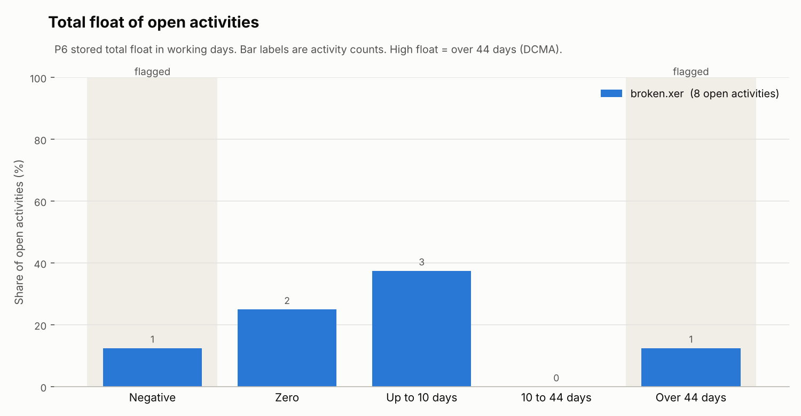

# XER schedule check

| | `broken.xer` |
|---|---|
| Project | DEMO |
| P6 export version | 19.12 |
| Text encoding (detected) | UTF-8 |
| Data date | 2026-11-01 |
| Activities (open / total) | 8 / 8 |
| Relationships | 7 |
| On P6 longest path (open) | 3 |
| **Broken rows** | **6** |
| **Missing links** | **1** |
| **Negative float** | **1** |
| **High float (> 44 days)** | **1** |
| Time to read and check | 0.00 s |

## broken.xer

Every finding is in [`broken_findings.csv`](broken_findings.csv). Up to 10 per check are shown here.

**Broken rows**

| Line | Table | Row | Problem |
|---|---|---|---|
| 14 | TASK | A50 | Total float is not a number: 'abc' |
| 15 | TASK | A60 | early_start_date is not a valid date: 'next tuesday' |
| 16 | TASK | A70 | Calendar 9 is not in the CALENDAR table |
| 17 | TASK | 80 | Row has 7 values but the table header has 10 |
| 27 | TASKPRED | 7 | Link points to a predecessor (999) that is not in this file |
| file |  |  | No %E end marker: the file may be cut off |

**Missing links** (1)

| Activity | Name | Finding |
|---|---|---|
| A30 | No links at all | No predecessor and no successor |

**Negative float** (1)

| Activity | Name | Finding |
|---|---|---|
| A20 | Linked, behind | -5.0 working days behind |

**High float** (1)

| Activity | Name | Finding |
|---|---|---|
| A40 | Lots of float | 50.0 working days of float |
