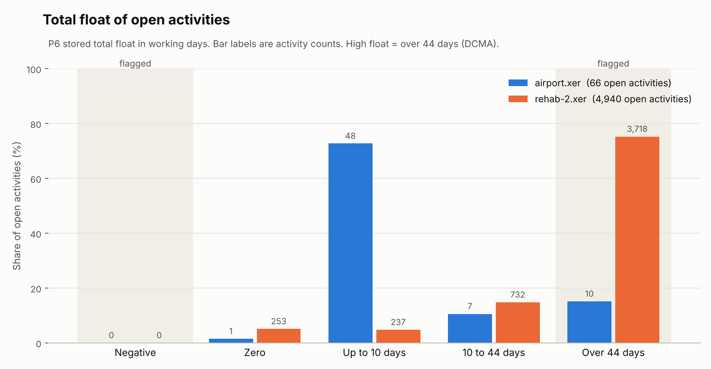

# XER schedule check

| | `airport.xer` | `rehab-2.xer` |
|---|---|---|
| Project | TERMINAL-2 | R111 |
| P6 export version | 5.0 | 6.0.0 |
| Text encoding (detected) | Windows Arabic (cp1256) | Windows Arabic (cp1256) |
| Data date | 2012-05-01 | 2008-05-27 |
| Activities (open / total) | 66 / 66 | 4,940 / 6,977 |
| Relationships | 84 | 10,730 |
| On P6 longest path (open) | 36 | not flagged in this export |
| **Broken rows** | **0** | **0** |
| **Missing links** | **0** | **10** |
| **Negative float** | **0** | **0** |
| **High float (> 44 days)** | **10** | **3,718** |
| Time to read and check | 0.01 s | 1.14 s |

## airport.xer

Every finding is in [`airport_findings.csv`](airport_findings.csv). Up to 10 per check are shown here.

**Broken rows:** none. Every row matches its table header, and every number, date, calendar and link checks out.

**Missing links:** none.

**Negative float:** none.

**High float** (10)

| Activity | Name | Finding |
|---|---|---|
| BA-P4-90 | P.C SOG | 107.0 working days of float |
| BA-P4-120 | R.C SOG | 107.0 working days of float |
| BA-P1-150 | LB Beams Works | 86.0 working days of float |
| BA-P3-100 | P.C SOG | 77.0 working days of float |
| BA-P3-110 | R.C SOG | 77.0 working days of float |
| BA-P1-160 | P.C SOG | 71.0 working days of float |
| BA-P1-170 | R.C SOG | 71.0 working days of float |
| BA-P1-140 | Hollow Core Slab Works | 68.0 working days of float |
| BA-P2-100 | P.C SOG | 59.0 working days of float |
| BA-P2-110 | R.C SOG | 59.0 working days of float |

## rehab-2.xer

Every finding is in [`rehab-2_findings.csv`](rehab-2_findings.csv). Up to 10 per check are shown here.

**Broken rows:** none. Every row matches its table header, and every number, date, calendar and link checks out.

**Missing links** (10)

| Activity | Name | Finding |
|---|---|---|
| V3110490 | أعمال الدهانات الخارجية | No successor |
| V3121155 | فك نجارة سقف الأول | No successor |
| V3203490 | أعمال الدهانات الخارجية | No successor |
| V3225490 | أعمال الدهانات الخارجية | No successor |
| V3227155 | فك نجارة سقف الأول | No successor |
| V3229135 | فك سقف الأرضى | No successor |
| V3230480 | أعمال الدهانات الخارجية | No successor |
| V3234155 | فك نجارة سقف الأول | No successor |
| V3236490 | أعمال الدهانات الخارجية | No successor |
| V3243490 | أعمال الدهانات الخارجية | No successor |

**Negative float:** none.

**High float** (3718)

| Activity | Name | Finding |
|---|---|---|
| V3268430 | سحب سلك كهرباء | 468.0 working days of float |
| V3273175 | فك نجارة سقف غرفة السطح | 458.0 working days of float |
| V3268350 | أرضيات سيراميك للحمامات | 454.0 working days of float |
| V3273430 | سحب سلك كهرباء | 454.0 working days of float |
| V3268200 | عزل أرضيات الحمامات | 452.0 working days of float |
| V3268250 | صرف وتغذية داخلية | 452.0 working days of float |
| V3268290 | أعمال سيراميك حوائط | 452.0 working days of float |
| V3268340 | أرضيات سيراميك للتراسات والمطابخ | 452.0 working days of float |
| V3268310 | H.D.F. بلاط أسمنتى أسفل | 450.0 working days of float |
| V3268320 | أرضيات رخام | 450.0 working days of float |
